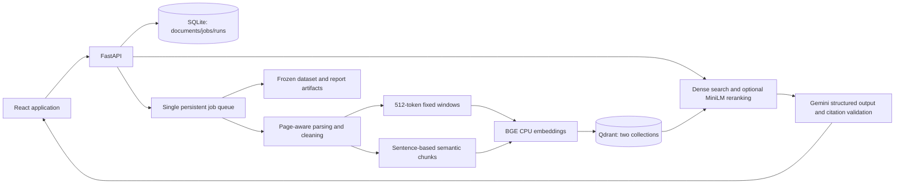

# Evidence Workbench

[](LICENSE)
[](https://www.python.org/download/releases/3.12/)
[](https://www.docker.com/)
[](https://github.com/anthropic/evaluation-driven-rag/actions)
[](https://github.com/astral-sh/ruff)

An evaluation-driven document QA application. Upload text-bearing PDFs or UTF-8 text files, compare fixed-chunk retrieval with semantic chunking + reranking, inspect page citations, and run reproducible NIST benchmarks.

> **Note**: Passing implementation tests does not establish that the enhanced strategy improves retrieval or that generated answers are faithful. See measured results below and preserved reports.

---

## Quick Start

### With Docker (recommended)

```sh
cp .env.example .env
# Configure GEMINI_API_KEY in .env locally; never commit it.
docker compose up -d --build --wait
```

Open [http://localhost:8080](http://localhost:8080). On Documents, open **Demo corpus setup**, then **Load demo corpus**. Wait for both publications to become ready.

### Local Development

```sh
make setup              # Install dependencies
make dev                # Start API and web dev server
```

- API: [http://127.0.0.1:8000](http://127.0.0.1:8000)
- Web: [http://127.0.0.1:8080](http://127.0.0.1:8080)

---

## Available Scripts

| Script | Description |
|---|---|
| `make setup` | Install dependencies (uv sync + frontend CI) |
| `make dev` | Start Qdrant, API, and web dev server |
| `make corpus` | Download NIST corpus |
| `make ingest-demo` | Ingest demo documents via API |
| `make benchmark` | Run evaluation benchmark |
| `make lint` | Run linters and type checks |
| `make test` | Run backend tests (85% coverage gate) |
| `make reset-demo` | Reset demo documents |

See [`Makefile`](Makefile) for full list.

---

## Architecture



---

## Configuration

All application variables and defaults are in [` .env.example`](.env.example). See [configuration details](docs/configuration.md) for their purpose.

Set `GEMINI_API_KEY` from [Google AI Studio](https://aistudio.google.com/apikey) in the server’s `.env`. With Docker, apply changes using `docker compose up -d --build --force-recreate api web`; restarting an existing container does not reload its environment. The default Gemini model currently supports free-tier text input/output. Quotas apply, and Google may use free-tier content to improve its products; see [Google pricing](https://ai.google.dev/gemini-api/docs/pricing).

Key settings:
- `QDRANT_URL=http://qdrant:6333` — Compose default; local needs `http://127.0.0.1:6333`
- `GEMINI_GENERATION_MODEL=gemini-3.5-flash-lite` — free-tier answer generation
- `GEMINI_EVALUATOR_MODEL=gemini-3.5-flash-lite` — free-tier evaluation judge
- `GEMINI_REQUESTS_PER_MINUTE=5` — shared pacing for generation and all judge requests; adjust to your AI Studio quota

---

## Measured Results

Production run `d2905419-562e-4be8-b882-edf9342507a4`, started 2026-10-19.

| Metric | Baseline | Enhanced | Delta |
|---|---:|---:|---:|
| hit_rate_at_5 | 0.5667 | 0.9000 | +0.3333 |
| precision_at_5 | 0.1200 | 0.1867 | +0.0667 |
| recall_at_5 | 0.5167 | 0.8167 | +0.3000 |
| mrr_at_5 | 0.3244 | 0.7833 | +0.4589 |

- **HitRate@5**: 17/30 → 27/30 (paired 95% bootstrap gain: +0.1333 to +0.5333)
- Median retrieval latency: 61.5 ms (baseline) vs 2679.3 ms (enhanced)
- Cross-encoder reranking accounts for most enhanced latency

[Full report](artifacts/evaluations/d2905419-562e-4be8-b882-edf9342507a4/report.md) · [Run JSON](artifacts/evaluations/d2905419-562e-4be8-b882-edf9342507a4/run.json) · [Verification analysis](docs/verification.md). Artifacts are git-ignored; export with a release if sharing.

---

## Limitations

- Born-digital English text only — no OCR, multilingual guarantee, or authentication
- PDFs may contain hostile instructions; evidence treated as untrusted text
- CPU latency reflects one host; BGE's 512-position limit includes special tokens
- Semantic chunking not guaranteed to improve every corpus

---

## Source & Dependency Licenses

- NIST publications: retained notices, downloaded from NIST, not redistributed
- PyMuPDF: AGPL/commercial terms — review upstream terms before distributing a hosted derivative
- BGE and MiniLM: licenses remain those of their respective model repositories

---

## Troubleshooting

- Failed document: choose same file to retry; repeated encrypted/scanned/invalid PDFs need valid text-bearing source
- Missing dependency at startup: restore Qdrant/model access and restart API
- Evaluation rejects missing/stale corpus versions: re-run demo ingestion, wait for ready, start new run
- Provider auth/timeout/rate-limit/schema errors: correct configuration and run new benchmark
- Faithfulness unavailable despite a configured key: inspect the evaluation error summary. A single missing judged case makes the aggregate unavailable. Request pacing reduces bursts, but cannot bypass daily/token quotas; a full benchmark at the default rate can take over an hour.
- `make reset-demo`: deletes only documents whose hashes match the pinned manifest; other uploads remain

---

## GitHub Actions

This repository uses GitHub Actions for CI. See `.github/workflows/` for CI configuration.

---

## License

MIT. NIST publications retain their own notices.
